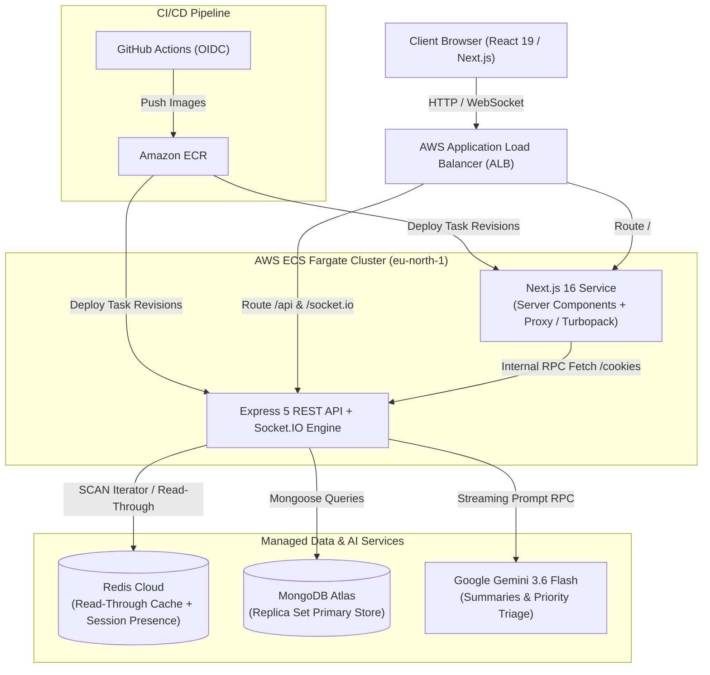
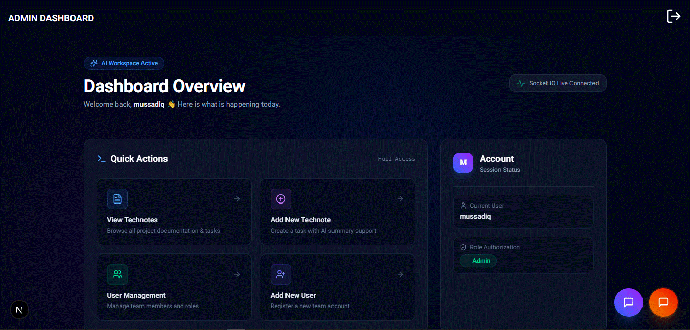
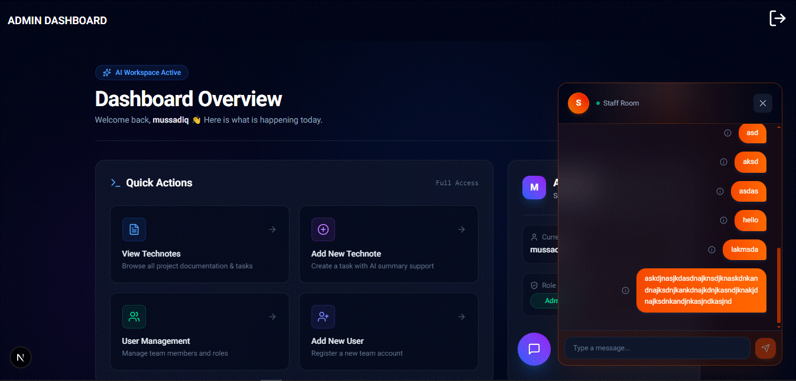
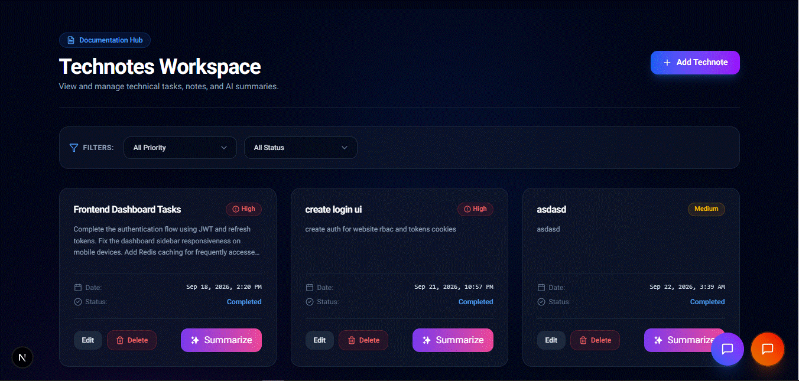
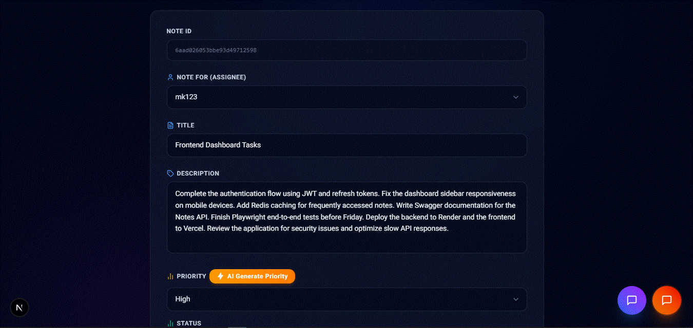
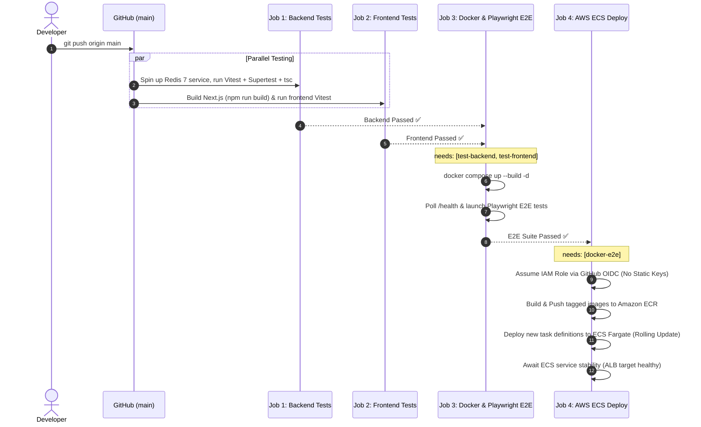

# TaskFlow AI — Enterprise Full-Stack Collaboration Platform

[](https://github.com/mussadiqkhan6886/TaskFlow_AI/actions/workflows/ci-cd.yaml)
[](https://nextjs.org/)
[](https://react.dev/)
[](https://www.typescriptlang.org/)
[](https://expressjs.com/)
[](https://aws.amazon.com/ecs/)
[](https://redis.io/)
[](https://www.mongodb.com/)
[](https://www.docker.com/)

A production-grade, distributed task management and team collaboration system engineered with **Next.js 16 (App Router)**, **Express 5**, **Redis**, **Socket.IO**, **MongoDB**, and **Google Gemini AI**. Built to demonstrate modern cloud-native full-stack architecture: fine-grained Role-Based Access Control (RBAC), multi-tier rate limiting, non-blocking Redis cache invalidation, automated JWT rotation, and zero-downtime CI/CD deployment to **AWS ECS Fargate** via **GitHub Actions OIDC**.

---

## 🌐 Live Deployment & Demo Credentials

- **Live Application:** [http://taskflow-alb-862843803.eu-north-1.elb.amazonaws.com](http://taskflow-alb-862843803.eu-north-1.elb.amazonaws.com)
- **Interactive Swagger Docs:** `/api-docs` on localhost only
- **Source Repository:** [github.com/mussadiqkhan6886/TaskFlow_AI](https://github.com/mussadiqkhan6886/TaskFlow_AI)

### Pre-Configured Demo Accounts

| Role | Username | Password | Access Surface |
| :--- | :--- | :--- | :--- |
| **Admin** | `mussadiq` | `mussadiq6886` | Full platform control: user CRUD, task assignment, staff chat, system audit |
| **Manager** | `manager` *(or created via Admin)* | `1234` | Team management, task creation/assignment, status escalation, staff chat |
| **Employee** | `mk123` | `mk1234` | Assigned tasks dashboard, status workflows, direct & team room messaging |

> **Security Notice:** The live demo endpoint runs behind an AWS Application Load Balancer over HTTP for evaluation. Do not input real-world or confidential credentials.

---

## 🏛️ System Architecture



### Architectural Highlights

1. **Hybrid Rendering Boundary**: Next.js 16 Server Components handle heavy initial data fetching and token verification at the container boundary; client components manage optimistic state and bidirectional WebSocket streams.
2. **Dual-Network Routing Topology**: Client browsers communicate through the AWS ALB over public interfaces (`http://localhost:4000` or public DNS), while Next.js Server Components query the Express backend directly over Docker bridge/VPC container networking (`http://backend:4000`), cutting latency and external bandwidth.
3. **Defense-in-Depth Identity**: Auth state is verified at the edge by the Next.js `proxy.ts` layer (using `jose`), verified at the Express API layer via `verifyJWT`, and enforced on Socket.IO handshakes via cookie parser middleware.

---

## 📸 Platform Capabilities in Action

| Dashboard Overview & RBAC | Real-Time Collaboration & Presence |
| :---: | :---: |
|  |  |
| *Role-aware analytics, active technotes, and AI workspace stats* | *Socket.IO rooms, live typing indicators, and read receipts* |

| Technote Lifecycle & Caching | AI Task Summarization & Triage |
| :---: | :---: |
|  |  |
| *Query filtering by status/priority backed by non-blocking Redis caching* | *Zero-shot priority auto-classification via Google Gemini AI* |

---

## ⚡ Core Engineering Highlights

### 1. Advanced State Management & Next.js 16 Architecture
- **Server Components & Server Actions**: Dashboard views fetch directly via typed Server Actions (`server/note.ts`, `server/user.ts`) using cookie forwarding via `cookies().toString()`.
- **TanStack React Query v5**:
  - Implements stale-while-revalidate caching (`staleTime: 30_000`) for network resilience.
  - Granular query invalidation (`queryClient.invalidateQueries({ queryKey: ['messages', room] })`) guarantees immediate cache synchronization upon mutation.
  - Loading skeletons, optimistic updates, and error toast integration using **Sonner**.
- **Edge-Ready Next.js Proxy (`frontend/proxy.ts`)**:
  - Leverages lightweight Web Crypto standard library `jose` for millisecond token verification.
  - Automatically intercepts expired access tokens and triggers silent, server-side refresh rotation, appending updated `set-cookie` headers before rendering without user interruption.

### 2. High-Performance Redis Caching Pattern
- **Non-Blocking Cache Invalidation**: Employs `redis.scanIterator({ MATCH: 'notes*' })` rather than dangerous blocking `KEYS *` commands, ensuring zero event-loop stalls under enterprise-scale key namespaces.
- **Deterministic Multi-Key Strategy**: Cache keys are structured dynamically:
  ```
  notes?all=true&priority=High&status=Working&noteFor=66f...
  ```
- **Read-Through Architecture**: Cache hits return in `<10ms` from memory; cache misses query MongoDB, serialize payloads with a deterministic 120-second TTL, and gracefully fallback to the database if Redis is unavailable.

### 3. Real-Time Distributed WebSockets (Socket.IO)
- **Handshake Authentication**: Sockets are authenticated during the initial HTTP upgrade handshake using `socketAuth.ts`, reading signed JWTs from request cookies.
- **Role & Entity Multiplexing**:
  - Dynamic room partitioning: `staff-room` (restricted to Admins & Managers) vs. `user-room` (organization-wide).
  - Private user notification channels (`io.to(userId).emit('notification-note', ...)`) for real-time task assignments.
- **Presence & Ephemeral State**: Global user presence tracking using memory sets (`online-users`), debounced typing indicators, and atomic message read acknowledgments.

### 4. High-Performance Chat Pagination
- **Lazy Loading:** Fetches only the latest 10 messages initially instead of the entire chat history.
- **Cursor-Based Pagination:** Loads older messages in batches of 10 on scroll using MongoDB ObjectId cursors instead of costly offset-based pagination.
- **Smooth UX:** Preserves scroll position, prevents duplicate messages, and integrates with real-time Socket.IO updates.

**Impact:** Reduces initial data transfer, database workload, and client-side rendering as chat history grows.

### 5. Zero-Trust Security & RBAC Enforcement
- **Dual-Token Rotation**:
  - **Access Token**: Short-lived (15 minutes), signed with HMAC SHA-256.
  - **Refresh Token**: Long-lived (7 days), stored strictly in `HttpOnly`, `SameSite=Strict`, `Secure` cookies.
- **Layered Rate Limiting**:
  - `loginLimiter`: Express rate-limiting to halt brute-force credential stuffing.
  - `aiLimiter`: Per-IP throttling on costly AI inference endpoints.
  - `apiLimiter`: Standard protection across mutating CRUD operations.
- **Runtime Schema Validation**: 100% of mutating payloads are validated through **Zod schemas** (`noteSchema`, `userSchema`) before touching controller logic or Mongoose layers, neutralizing prototype pollution and invalid casts.

### 6. Automated AI Workflow (Google Gemini 3.6 Flash)
- **Structured Zero-Shot Prompting**: Integrates Google Gen AI SDK for automated task triage. Formats unformatted technical tasks into structured summaries and validates single-token priority classifications (`High`, `Medium`, `Low`).
- **Cost-Optimized Backend Proxy**: AI calls execute strictly server-side, preventing client-side API key leakage and maintaining centralized rate limits.

---

## 🛠️ Technology Stack Breakdown

| Layer | Technologies | Justification & Architecture Notes |
| :--- | :--- | :--- |
| **Frontend Framework** | **Next.js 16** (App Router), **React 19** | Hybrid SSR/CSR, streaming Suspense, Turbopack builds, standalone Docker compilation. |
| **Client State & Cache**| **TanStack React Query v5** | Server-state caching, background refetching, mutation lifecycle hooks. |
| **Styling & UI** | **Tailwind CSS v4**, **Lucide Icons** | Zero-runtime CSS engine, dark-mode developer aesthetic, responsive flex/grid layouts. |
| **API Server** | **Express 5**, **Node.js 22 LTS** | Native async route handlers, centralized error pipelines, modular router patterns. |
| **Data Persistence** | **MongoDB Atlas**, **Mongoose 8** | Flexible document modeling, indexing on query filters, schema-level validation. |
| **In-Memory Cache** | **Redis Cloud** (v7) | Read-through caching, sub-millisecond query responses, non-blocking SCAN invalidation. |
| **Real-Time Engine** | **Socket.IO 4.8** | Low-latency duplex communication, role-based rooms, presence state. |
| **AI Inference** | **Google Gemini AI SDK** | `gemini-3.6-flash` integration for task summarization and automated priority assignment. |
| **Testing Suite** | **Vitest**, **Supertest**, **Playwright** | In-memory Mongo unit/API testing, browser E2E automation against Docker containers. |
| **Containerization** | **Docker**, **Docker Compose** | Production multi-stage builds (`node:24-alpine`), lean standalone artifacts. |
| **Cloud Infrastructure**| **AWS ECS Fargate**, **ECR**, **ALB** | Serverless container orchestration, rolling zero-downtime updates, managed ingress. |
| **CI/CD Pipeline** | **GitHub Actions**, **AWS OIDC** | Keyless IAM role federation, parallel unit/integration gates, automated deployment. |

---

## 📂 Project Structure

```text
TaskFlow_AI/
├── .github/
│   └── workflows/
│       └── ci-cd.yaml             # Complete CI/CD: Vitest -> Docker Compose E2E -> AWS OIDC -> ECR -> ECS
├── backend/
│   ├── src/
│   │   ├── config/                # Redis, MongoDB, Socket, Swagger & Gemini configurations
│   │   ├── controllers/           # Auth, User, Note, Message & AI request handlers
│   │   ├── middleware/            # JWT verification, RBAC guards, rate-limiters, error pipeline
│   │   ├── models/                # Mongoose schemas (User, Note, Message)
│   │   ├── routes/                # Modular REST route definitions with Swagger annotations
│   │   ├── schemas/               # Zod input validation schemas
│   │   ├── service/               # Gemini AI prompt orchestration service
│   │   ├── socket/                # Socket.IO connection lifecycle, room routing & event handlers
│   │   └── app.ts                 # Express application setup, CORS & global middleware
│   ├── __tests__/                 # Vitest + Supertest integration suites (MongoMemoryServer)
│   └── Dockerfile                 # Multi-stage production container build
├── frontend/
│   ├── app/                       # Next.js 16 App Router (Client landing & Admin workspaces)
│   ├── components/                # Reusable UI widgets, Chat overlays, Note cards, Skeletons
│   ├── lib/                       # API base URL resolution, Server Action helpers, utilities
│   ├── server/                    # Server Actions interfacing with the backend service
│   ├── socket/                    # Socket.IO client singleton & event emitters
│   ├── proxy.ts                   # Next.js edge-compatible token verification & silent refresh
│   ├── __tests__/                 # React Testing Library & Vitest component tests
│   └── Dockerfile                 # Standalone Next.js multi-stage production container
├── e2e/
│   ├── tests/                     # Playwright suites (auth.spec, dashboard.spec, notes.spec, users.spec)
│   └── playwright.config.ts       # Headless Chromium E2E configuration targeting live containers
├── compose.yaml                   # Docker Compose orchestrating internal service network
└── README.md
```

---

## 🔄 CI/CD & Deployment Workflow

The production pipeline in [`.github/workflows/ci-cd.yaml`](.github/workflows/ci-cd.yaml) enforces strict quality gates before any code reaches production:



### Enterprise Deployment Security
- **Keyless Authentication**: Uses **AWS IAM OIDC Federation**, eliminating the need for long-lived AWS Access Keys in repository secrets.
- **Fail-Safe Rollbacks**: `wait-for-service-stability: true` monitors ECS health probes. If new tasks fail health checks, AWS automatically halts the rollout and keeps existing healthy tasks alive.

---

## 🧪 Comprehensive Testing Pyramid

The project maintains test coverage across all application tiers:

### 1. Backend Unit & Integration Tests (Vitest + Supertest)
```bash
cd backend
npm run test:run
```
- Runs in-memory MongoDB replica instances using `mongodb-memory-server`.
- Tests controller responses, RBAC permission violations (`401 Unauthorized`, `403 Forbidden`), and Zod validation boundaries.
- Validates Redis cache hit/miss behavior and automatic cache invalidation upon mutations.

### 2. Frontend Component Tests (Vitest + React Testing Library)
```bash
cd frontend
npm run test:run
```
- Tests component rendering, search input debouncing, modal interactions, and role-conditioned UI visibility.
- Mocks TanStack Query hooks and Next.js navigation stubs.

### 3. End-to-End Browser Tests (Playwright)
```bash
cd e2e
npx playwright test
```
- Executes headless Chromium automation across live containers.
- Tests multi-role flows: Employee vs. Manager vs. Admin dashboard visibility, task creation, status updates, and session cookie persistence.

---

## 🚀 Local Development Setup

### Prerequisites
- **Node.js**: `v22.x` or `v24.x`
- **Docker & Docker Compose**: Recent version supporting Compose v2
- **MongoDB**: Local URI or free MongoDB Atlas cluster
- **Redis**: Local instance or free Redis Cloud instance

### Option A: Running with Docker Compose (Recommended)

1. **Clone Repository:**
   ```bash
   git clone https://github.com/mussadiqkhan6886/TaskFlow_AI.git
   cd TaskFlow_AI
   ```

2. **Configure Environment Files:**
   Create `backend/.env`:
   ```env
   PORT=4000
   NODE_ENV=production
   MONGODB_URI=your_mongodb_connection_string
   REDIS_HOST=your_redis_host
   REDIS_PORT=your_redis_port
   REDIS_PASSWORD=your_redis_password
   ACCESS_TOKEN=access_token
   REFRESH_TOKEN=refresh_token
   GEMINI_AI_API_KEY=your_gemini_api_key
   FRONTEND_URL=http://localhost:3000
   BACKEND_URL=http://localhost:4000
   ```

   Create `frontend/.env`:
   ```env
   NEXT_PUBLIC_BASE_URL=http://localhost:4000
   INTERNAL_API_URL=http://backend:4000
   ACCESS_TOKEN=access_token
   ```

3. **Build & Launch Containers:**
   ```bash
   docker compose up --build -d
   ```
   - **Frontend UI:** `http://localhost:3000`
   - **Backend API & Swagger:** `http://localhost:4000/api-docs`

---

### Option B: Running Bare-Metal for Local Development

1. **Start Backend Server:**
   ```bash
   cd backend
   npm install
   npm run dev
   ```

2. **Start Frontend Client:**
   ```bash
   cd frontend
   npm install
   npm run dev
   ```

---

## 📡 REST API Reference (Sample)

| Method | Endpoint | Authorization | Description | Cache Behavior |
| :--- | :--- | :--- | :--- | :--- |
| `POST` | `/api/auth/login` | Public | Authenticates user; issues access + refresh cookies | Rate-limited (5 req / 15 min) |
| `POST` | `/api/auth/refresh` | Cookie (`refreshToken`) | Rotates refresh token & issues fresh access token | Bypasses cache |
| `POST` | `/api/auth/logout` | Public | Clears authentication cookies from client | Bypasses cache |
| `GET` | `/api/users/me` | Employee, Manager, Admin | Retrieves current authenticated session | Cached (120s TTL) |
| `GET` | `/api/notes` | Employee, Manager, Admin | Lists tasks (Employees see only their assigned tasks) | Cached by query params (120s TTL) |
| `POST` | `/api/notes` | Manager, Admin | Creates a new task and dispatches notification | Invalidates `notes*` cache pattern |
| `PATCH` | `/api/notes/:id` | Employee, Manager, Admin | Updates note status/priority (ownership verified) | Invalidates key & `notes*` pattern |
| `DELETE`| `/api/notes/:id` | Admin | Deletes task record | Invalidates key & `notes*` pattern |
| `POST` | `/api/ai/generate` | Employee, Manager, Admin | Calls Gemini for task summary or priority triage | Rate-limited by `aiLimiter` |

*Full OpenAPI 3.0 specification available at `/api-docs`.*

---

## 👨‍💻 Engineering Leadership & Author

**Mussadiq Khan**  
*Full-Stack Software Engineer*  
- **GitHub:** [@mussadiqkhan6886](https://github.com/mussadiqkhan6886)  
- **Email:** mussadiqkhan6886@gmail.com  
- **LinkedIn:** [linkedin.com/in/mussadiq-khan](https://www.linkedin.com/in/mussadiq-khan/)

*Constructed to demonstrate senior-level software engineering: clean separation of concerns, defensive security practices, high-throughput caching, resilient automated pipelines, and cloud-native infrastructure.*
