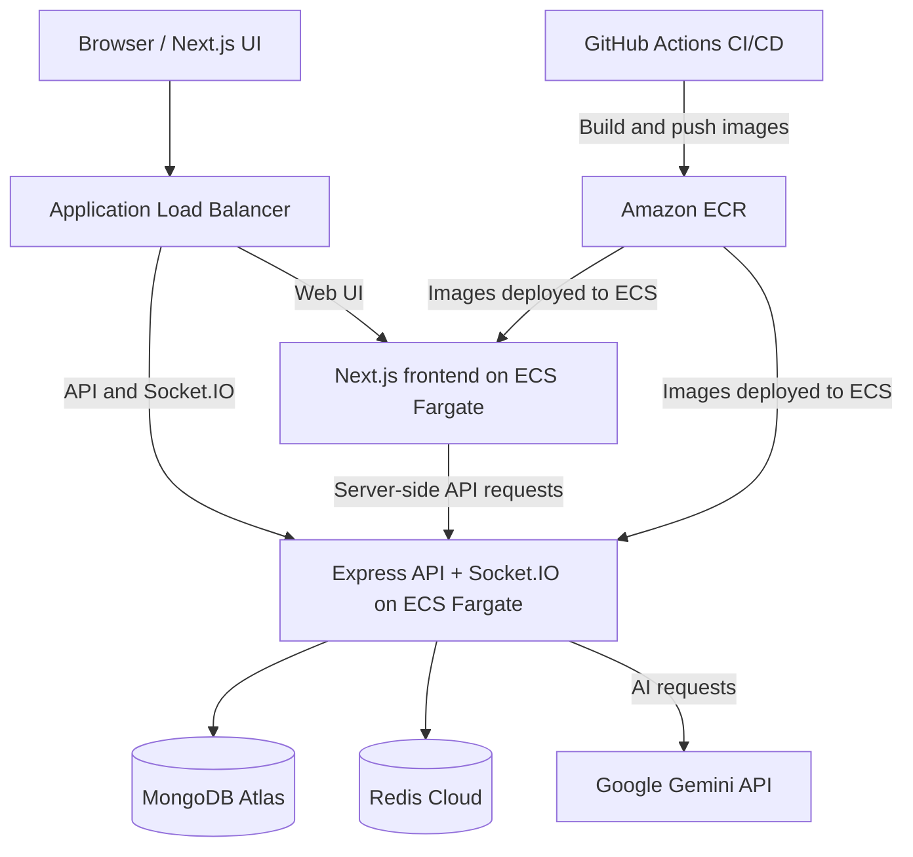

# TaskFlow AI

A full-stack task management and team collaboration platform with
role-based access control, real-time communication, Redis caching, and
AI-powered task assistance.

TaskFlow AI demonstrates end-to-end application engineering: typed
frontend and backend code, secure authentication patterns, validated
APIs, real-time events, automated tests, Docker-based integration
testing, and CI/CD deployment to AWS ECS.

**Live demo:**
http://taskflow-alb-862843803.eu-north-1.elb.amazonaws.com\
**Repository:** https://github.com/mussadiqkhan6886/TaskFlow_AI

> **Deployment note:** The current demo URL uses HTTP. Do not use real
> or sensitive credentials on an HTTP deployment. Configure HTTPS with a
> domain you control before presenting the app for real-world use.

------------------------------------------------------------------------

## Contents

-   [Highlights](#highlights)
-   [Screenshots](#screenshots)
-   [Features](#features)
-   [Architecture](#architecture)
-   [Technology stack](#technology-stack)
-   [Repository structure](#repository-structure)
-   [How the application works](#how-the-application-works)
-   [Run locally](#run-locally)
-   [Environment variables](#environment-variables)
-   [Docker](#docker)
-   [Testing](#testing)
-   [CI/CD and AWS deployment](#cicd-and-aws-deployment)
-   [Security considerations](#security-considerations)
-   [Future improvements](#future-improvements)
-   [Author](#author)

------------------------------------------------------------------------

## Highlights

-   **Authentication:** JWT access and refresh-token flow, HTTP-only
    cookies, password hashing, and protected routes.
-   **Authorization:** Admin, Manager, and Employee roles with
    server-side permission checks.
-   **Task management:** Task creation, assignment, priorities, status
    tracking, and ownership-aware updates.
-   **AI assistance:** Google Gemini-powered summaries and priority
    suggestions.
-   **Real-time collaboration:** Socket.IO chat, presence, read
    receipts, and notifications.
-   **Caching:** Redis cache with explicit invalidation on writes and
    TTL safeguards.
-   **Validation:** TypeScript and Zod validation at API boundaries.
-   **Testing:** Backend tests, frontend component tests, and Playwright
    end-to-end tests.
-   **Deployment:** Docker images published to Amazon ECR and services
    deployed to Amazon ECS Fargate through GitHub Actions.

## Screenshots

### Dashboard


### Real-time chat


### Notes


### Priority suggestions


------------------------------------------------------------------------

## Features

### Authentication and access control

-   JWT-based authentication using access and refresh tokens.
-   Refresh-token flow using HTTP-only cookies.
-   Password hashing with bcrypt.
-   Protected API routes and role-based authorization middleware.
-   Zod validation for mutating API requests.
-   Server-side authorization checks rather than relying only on hidden
    UI elements.

### Role-based permissions

  -----------------------------------------------------------------------
  Role                                Typical permissions
  ----------------------------------- -----------------------------------
  **Admin**                           Manage users and tasks; access
                                      staff communication features.

  **Manager**                         Create and assign tasks, manage
                                      team tasks, and access staff chat.

  **Employee**                        View assigned tasks, update
                                      permitted task statuses, and
                                      communicate with the team.
  -----------------------------------------------------------------------

Actual access is determined by the application's backend authorization
rules.

### Tasks and notes

-   Create, assign, and update tasks.
-   Set Low, Medium, or High priority.
-   Track work through Pending, In Progress, and Completed states.
-   Apply role and ownership rules to task visibility and updates.
-   Organize notes and use AI assistance when appropriate.

### AI assistance

Google Gemini is called through the backend for:

-   **AI summaries:** Condense task or note content into a shorter
    summary.
-   **Priority suggestions:** Suggest a priority based on the supplied
    content.

AI output is a recommendation, not an authoritative decision. Users
retain control over the final task data. The Gemini API key should
remain on the server and must never be exposed in client-side code.

### Real-time collaboration with Socket.IO

-   Real-time team chat.
-   Online/offline presence.
-   Read receipts.
-   Push notifications for connected users.

REST is used for normal resource operations, while Socket.IO delivers
events that need to reach connected clients promptly. This avoids
repeatedly polling the API for every real-time update.

### Redis caching

-   Cache selected frequently read data.
-   Reduce repeated database reads on cache hits.
-   Invalidate relevant cache entries after writes.
-   Use TTLs as a fallback safeguard against stale cache entries.

MongoDB remains the persistent source of truth; Redis is used as a cache
and should not be treated as the permanent store for application
records.

------------------------------------------------------------------------

## Architecture



### Component responsibilities

  -----------------------------------------------------------------------
  Component                           Responsibility
  ----------------------------------- -----------------------------------
  **Next.js frontend**                UI rendering, client interactions,
                                      and live updates.

  **Express backend**                 API business logic, authentication,
                                      authorization, validation, and
                                      integrations.

  **Socket.IO**                       Real-time chat, presence, read
                                      receipts, and notifications.

  **MongoDB Atlas**                   Persistent application data.

  **Redis Cloud**                     Cache for selected frequently
                                      accessed data.

  **Google Gemini API**               On-demand AI summaries and priority
                                      suggestions.

  **Application Load Balancer**       Routes browser traffic to the
                                      frontend and API/WebSocket traffic
                                      to the backend.

  **Amazon ECS Fargate**              Runs the frontend and backend
                                      containers.

  **Amazon ECR**                      Stores versioned container images.

  **GitHub Actions**                  Runs checks, builds images, pushes
                                      images, and deploys ECS services.
  -----------------------------------------------------------------------

------------------------------------------------------------------------

## Technology stack

### Frontend

-   Next.js 16 App Router
-   React 19
-   TypeScript
-   Tailwind CSS v4
-   TanStack React Query
-   Socket.IO Client
-   React Markdown
-   Sonner
-   Lucide Icons

### Backend

-   Node.js
-   Express 5
-   TypeScript
-   MongoDB and Mongoose
-   Redis
-   Socket.IO
-   JSON Web Tokens (JWT)
-   bcrypt
-   Zod
-   Swagger / OpenAPI documentation

### Testing and delivery

-   Vitest
-   Supertest
-   MongoDB Memory Server
-   React Testing Library
-   Playwright
-   Docker and Docker Compose
-   GitHub Actions
-   Amazon ECR
-   Amazon ECS Fargate
-   Amazon IAM Role
-   Application Load Balancer
-   AWS Secrets Manager
-   Amazon CloudWatch

------------------------------------------------------------------------

## Repository structure

``` text
TaskFlow_AI/
├── .github/
│   └── workflows/
│       └── ci-cd.yaml
├── backend/
│   ├── src/
│   │   ├── controllers/
│   │   ├── models/
│   │   ├── routes/
│   │   ├── middleware/
│   │   ├── services/
│   │   ├── config/
│   │   ├── socket/
│   │   ├── schemas/
│   │   └── lib/
│   └── __tests__/
├── frontend/
│   ├── __tests__/
│   ├── app/
│   ├── components/
│   ├── lib/
│   ├── hooks/
│   ├── socket/
│   ├── server/
│   └── public/
├── e2e/
│   └── helpers/
│   └── tests/
├── compose.yaml
└── README.md
```

Individual files may vary as the project evolves.

------------------------------------------------------------------------

## How the application works

1.  A user signs in and the backend validates the credentials.
2.  The backend issues authentication tokens using the configured token
    flow.
3.  Protected requests pass through authentication, authorization, and
    validation middleware.
4.  The backend reads eligible cached data from Redis; on a cache miss,
    it queries MongoDB and may populate the cache.
5.  Create, update, and delete operations persist changes in MongoDB and
    invalidate affected cache entries.
6.  Socket.IO emits chat, presence, and notification events to the
    relevant connected clients.
7.  When a user requests an AI summary or priority suggestion, the
    backend calls Gemini and returns the result to the frontend.

------------------------------------------------------------------------

## Run locally

### Prerequisites

Install the following:

-   Git
-   Node.js and npm (use a version compatible with the repository's
    package configuration)
-   Access to MongoDB Atlas or a local MongoDB instance
-   Access to Redis Cloud or a local Redis instance
-   A Google Gemini API key for AI features

### 1. Clone the repository

``` bash
git clone https://github.com/mussadiqkhan6886/TaskFlow_AI.git
cd TaskFlow_AI
```

### 2. Install backend dependencies

``` bash
cd backend
npm install
```

Create `backend/.env` using the variables in the [Environment
variables](#environment-variables) section.

### 3. Start the backend

From the `backend` directory:

``` bash
npm run dev
```

The backend is configured to use port `4000` by default.

### 4. Install frontend dependencies

Open a second terminal from the repository root:

``` bash
cd frontend
npm install
```

Create `frontend/.env` using the variables below.

### 5. Start the frontend

From the `frontend` directory:

``` bash
npm run dev
```

The frontend is configured to use `http://localhost:3000`; the backend
defaults to `http://localhost:4000`.

Check the backend's configured Swagger/OpenAPI route for API
documentation after the backend starts.

------------------------------------------------------------------------

## Environment variables

Variable names and requirements should be checked against the current
application configuration. Use placeholders in documentation only; never
commit real credentials.

### `backend/.env`

``` env
PORT=4000
MONGODB_URI=your_mongodb_connection_string
REDIS_HOST=your_redis_host
REDIS_PORT=your_redis_port
REDIS_PASSWORD=your_redis_password
ACCESS_TOKEN=your_access_token_secret
REFRESH_TOKEN=your_refresh_token_secret
GEMINI_AI_API_KEY=your_gemini_api_key
FRONTEND_URL=http://localhost:3000
BACKEND_URL=http://localhost:4000
```

### `frontend/.env`

``` env
NEXT_PUBLIC_BASE_URL=http://localhost:4000
ACCESS_TOKEN=the_matching_access_token_secret
```

**Important environment notes:**

-   The frontend's `ACCESS_TOKEN` value must match the backend's signing
    secret if the frontend performs server-side token verification with
    that secret.
-   `NEXT_PUBLIC_*` variables can be embedded in the browser bundle
    during the Next.js build. Never place secrets in a `NEXT_PUBLIC_*`
    variable.
-   In Docker Compose, the browser-facing URL and the
    container-to-container URL may differ. The browser typically uses
    `localhost` on a developer machine, while a frontend container can
    use a Docker service hostname such as `http://backend:4000` for
    server-side requests.
-   Do not commit `.env` files. Use `.env.example` files with
    placeholder values when documenting configuration.
-   In AWS, configure production secrets using AWS Secrets Manager and
    the task definition's secret references.

------------------------------------------------------------------------

## Docker

If the repository's Docker Compose configuration is present, you can
build and start the services from the repository root:

``` bash
docker compose up --build
```

Stop the services with:

``` bash
docker compose down
```

MongoDB Atlas and Redis Cloud are external services in the deployed
setup; they do not need to run as Compose containers if your environment
is configured to use those managed services.

Before running Compose, ensure the environment files and required
variables are configured. Never put production secrets in a committed
Compose file.

------------------------------------------------------------------------

## Testing

Run tests from the relevant project directory.

### Backend tests

``` bash
cd backend
npm install
npm run build
npm run test:run
```

The backend test suite includes unit and API/integration coverage. Tests
use an in-memory MongoDB setup where configured, so test runs do not
need to write to the production database.

### Frontend tests

``` bash
cd frontend
npm install
npm run build
npm run test:run
```

The frontend suite uses Vitest and React Testing Library.

### End-to-end tests

``` bash
cd e2e
npm install
npx playwright install chromium
npx playwright test
```

Run the end-to-end suite against the environment configured by the
Playwright setup. For CI, the workflow builds and starts the Dockerized
application before running browser tests.

If a test fails, inspect the Playwright report, screenshot, video,
trace, and application logs. Do not treat a retry passing as proof that
a persistent application error is fixed.

------------------------------------------------------------------------

## CI/CD and AWS deployment

The GitHub Actions workflow is defined in
[`.github/workflows/ci-cd.yaml`](.github/workflows/ci-cd.yaml).

The deployment pipeline is designed to:

1.  Run backend build and tests.
2.  Build the frontend and run its tests.
3.  Build and start the Dockerized application for end-to-end testing.
4.  Run Playwright browser tests and retain diagnostic artifacts on
    failure.
5.  Authenticate to AWS using GitHub Actions OIDC.
6.  Build and push versioned frontend and backend images to Amazon ECR.
7.  Update the ECS task definitions to use the new image tags.
8.  Deploy the frontend and backend services to Amazon ECS Fargate and
    wait for service stability.

The production setup uses an Application Load Balancer to route web
requests and API/Socket.IO traffic to the appropriate ECS services.
MongoDB Atlas and Redis Cloud remain external managed services. AWS
Secrets Manager stores backend secrets, and CloudWatch collects
container logs.

### Deployment safety checklist

-   Protect `main` with branch rules and required status checks.
-   Keep AWS credentials and API secrets out of the repository.
-   Restrict the GitHub OIDC IAM role to the intended repository and
    branch.
-   Confirm the new ECS tasks are healthy after each deployment.
-   Verify the running image tags match the commit that was deployed.
-   Review CloudWatch logs after a release.
-   Keep a documented rollback path to a known-good task definition and
    image.

Exact workflow behavior depends on the current configuration in the
repository. Review the workflow file before changing triggers, required
jobs, or deployment conditions.

------------------------------------------------------------------------

## Security considerations

-   Enforce authorization on the backend for every protected resource
    and action.
-   Keep access-token signing secrets, refresh-token secrets, database
    credentials, and AI keys out of source control.
-   Use HTTPS for real users and configure secure cookie attributes
    appropriately.
-   Validate and normalize untrusted input at API boundaries.
-   Apply appropriate rate limits to authentication and costly AI
    endpoints.
-   Avoid logging credentials, tokens, or sensitive user content.
-   Review CORS origins and database/network access rules before
    production use.
-   Treat AI-generated content as untrusted suggestions and validate it
    before using it in application logic.

------------------------------------------------------------------------

## Future improvements

Potential next steps include:

-   Configure a custom domain and HTTPS.
-   Add pagination and infinite scrolling for large task and message
    lists.
-   Add AI automation to create tasks and assign to user automatically 

------------------------------------------------------------------------

## Author

**Mussadiq Khan**

-   GitHub: [@mussadiqkhan6886](https://github.com/mussadiqkhan6886)
-   Project: [TaskFlow
    AI](https://github.com/mussadiqkhan6886/TaskFlow_AI)

------------------------------------------------------------------------

## License

No license information was supplied in the project material. Add a
`LICENSE` file and update this section if you intend to distribute the
project under a specific open-source license.
